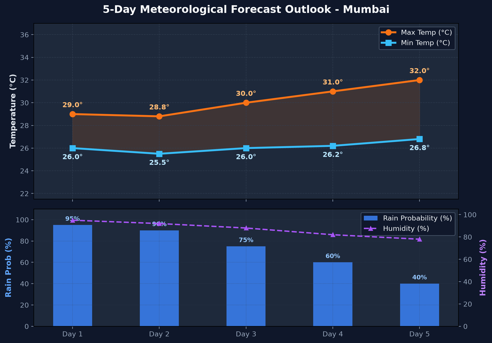

# 🌤️ Weather Forecast & Alert Application
### *Industry-Grade Meteorological Telemetry, Automated Risk Analysis & Interactive Weather Control Center*


-brightgreen)


---

## 📌 Project Overview

The **Weather Forecast & Alert Application** is a production-grade Python system engineered to ingest real-time meteorological observations, forecast multi-day atmospheric trajectories, evaluate domain-specific risk conditions against configurable safety thresholds, and issue actionable, multi-tier safety alerts.

Unlike basic tutorial weather scripts that simply print raw temperatures, this system acts as an **automated risk intelligence platform** suited for supply chain logistics, precision agriculture, outdoor aviation/maritime operations, municipal disaster management, and daily commute safety.

It features a **zero-dependency multi-tier failover architecture**:
1. **Authenticated Live API:** OpenWeatherMap 2.5 RESTful endpoints.
2. **Zero-Key Public Live API:** Open-Meteo Meteorological Geocoding & Forecast service.
3. **Virtual Simulation Lab:** Pre-loaded synthetic and empirical extreme weather scenarios (`Phoenix` heatwave, `Mumbai` severe thunderstorm, `Chicago` freezing blizzard, `Tokyo` typhoon bands, `London` overcast).

## 📸 Output Screenshots


## 🎥 Demo Video

https://youtu.be/9IrCCsTbsAA?si=y4HVwHPm84R5lHpB

---

## 💡 Problem Statement & Industry Relevance

Adverse weather phenomena cause billions of dollars in annual losses and severe disruptions:
- **Agriculture & Farming:** Sudden frost or unseasonal heavy rain ruins cash crops; timely alerts trigger protective measures or adjusted irrigation.
- **Logistics & Fleet Operations:** Gale-force winds and downpours trigger road closures and threaten temperature-sensitive cold chains.
- **Aviation & Marine:** Barometric pressure drops, violent squalls, and severe storm bands require rerouting.
- **Event Management & Tourism:** Outdoor concerts, athletic events, and travel tours need predictive contingency planning.

### System Solution
This application continuously monitors critical atmospheric vectors:
- **Temperature extremes:** Heat waves ($\ge 35^\circ\text{C}$) and freezing conditions ($\le 0^\circ\text{C}$).
- **Precipitation & Storms:** Active rain rate, thunderstorm detection, and $80\%+$ forward rain probability.
- **Wind Velocity:** Gale-force winds ($\ge 40\text{ km/h}$) endangering transport and scaffolding.
- **Relative Humidity:** Muggy conditions ($\ge 85\%$) causing indoor mold risk and high heat index exhaustion.

---

## 🏗️ System Architecture & Data Flow

```
┌────────────────────────────────────────────────────────────────────────┐
│                              USER CLIENT                               │
│            Interactive CLI Terminal Menu   /   Streamlit Web UI        │
└───────────────────────────────────┬────────────────────────────────────┘
                                    │
                                    ▼
┌────────────────────────────────────────────────────────────────────────┐
│                      TELEMETRY ROUTER & API CLIENT                     │
│   [OpenWeatherMap API]  <───>  [WeatherAPIClient]  <───> [Open-Meteo]  │
│                                   │                                    │
│                                   ▼                                    │
│                     [Virtual Simulation Lab (JSON)]                    │
└───────────────────────────────────┬────────────────────────────────────┘
                                    │
                                    ▼
┌────────────────────────────────────────────────────────────────────────┐
│                     DATA NORMALIZATION & PARSER                        │
│                     [WeatherParser Standardizer]                       │
│      - Uniform Schema Mapping     - WMO Weather Code Translation       │
└───────────────────────────────────┬────────────────────────────────────┘
                                    │
                                    ▼
┌────────────────────────────────────────────────────────────────────────┐
│                       ALERT & RISK EVALUATION RADAR                    │
│                        [AlertEngine Rules Engine]                      │
│      - Heat Wave Check            - Freezing Frost Check               │
│      - Gale Force Wind Check      - Severe Storm & Rain Pattern        │
└───────────────────┬────────────────────────────────┬───────────────────┘
                    │                                │
                    ▼                                ▼
┌──────────────────────────────────────┐  ┌──────────────────────────────┐
│         VISUALIZATION ENGINE         │  │       REPORTING ENGINE       │
│      [Matplotlib & Plotly Trends]    │  │ [CSV / JSON / Text Exporter] │
│ - Dual-panel Temperature Envelope    │  │ - Tabular 5-Day Forecast CSV │
│ - Precipitation Probability Bars     │  │ - Machine-readable JSON Log  │
│ - Interactive Streamlit Gauges       │  │ - Executive Text Audit File  │
└──────────────────────────────────────┘  └──────────────────────────────┘
```

---

## 🚀 Key Features

- **🌐 Zero-Friction Live Execution:** Ingest live meteorological telemetry for any global city without requiring registration or API keys via Open-Meteo.
- **🔑 Production API Key Support:** Full integration with OpenWeatherMap API with secure `.env` credential management.
- **🧪 Offline Virtual Simulation Lab:** Deterministic test fixtures for extreme weather scenarios to facilitate academic grading and CI/CD validation.
- **🚨 Multi-Tier Alert Radar:** Categorized into `CRITICAL`, `WARNING`, and `ADVISORY` with actionable domain safety guidelines.
- **📈 Publication-Quality Visualizations:** Matplotlib dual-panel plots showing temperature envelopes and rain likelihood, plus interactive Plotly curves.
- **📑 Multi-Format Report Center:** One-click automated exports in tabular CSV, structured JSON audit logs, and executive text briefings.
- **🖥️ Dual Mode Interfaces:** Rich interactive console CLI and modern responsive Streamlit web dashboard.

---

## 📂 Project Directory Structure

```text
Weather-Forecast-Alert-Application/
│
├── data/
│   ├── sample_weather.json         # Realistic synthetic weather scenarios for offline testing
│   └── historical_logs.csv         # Persistent historical audit log of weather & alerts
│
├── src/
│   ├── __init__.py                 # Package declaration and version metadata
│   ├── config.py                   # Centralized configuration, paths, and .env loader
│   ├── api_client.py               # Resilient multi-source API router with failover
│   ├── parser.py                   # Canonical JSON normalizer & WMO code translator
│   ├── alert_engine.py             # Rule-based threshold evaluation and alert generator
│   ├── visualizer.py               # Matplotlib dual-panel publication-grade chart generator
│   └── reporter.py                 # Multi-format report exporter (CSV, JSON, Text)
│
├── outputs/                        # High-resolution generated charts
│   ├── forecast_london.png
│   └── forecast_mumbai.png
│
├── images/                         # Portfolio screenshots & diagrams for documentation
│   ├── forecast_chart.png
│   └── forecast_mumbai.png
│
├── reports/                        # Automated session audit logs and CSV forecasts
│   ├── forecast_london_*.csv
│   ├── audit_mumbai_*.json
│   └── report_london_*.txt
│
├── docs/                           # Comprehensive technical documentation
│   ├── ARCHITECTURE.md             # Deep-dive system design & data flow
│   ├── INTERVIEW_PREP.md           # 10 top technical interview questions with STAR answers
│   └── SIMULATION_GUIDE.md         # Virtual simulation scenarios & grading walkthrough
│
├── .env.example                    # Clean environment variable template
├── .gitignore                      # Prevents leaking keys, virtual environments, and cache
├── requirements.txt                # Pinned project dependencies
├── main.py                         # Interactive CLI Application entrypoint
├── app.py                          # Streamlit Interactive Web Application
└── README.md                       # Comprehensive repository documentation
```

---

## ⚙️ Installation & Setup Guide

### 1. Clone or Download Repository
```bash
git clone https://github.com/your-username/Weather-Forecast-Alert-Application.git
cd Weather-Forecast-Alert-Application
```

### 2. Create and Activate Virtual Environment
#### On Windows (PowerShell):
```powershell
python -m venv venv
.\venv\Scripts\Activate.ps1
```
#### On macOS / Linux:
```bash
python3 -m venv venv
source venv/bin/activate
```

### 3. Install Dependencies
```bash
pip install -r requirements.txt
```

### 4. Configure Environment Variables (Optional for OpenWeatherMap)
The application works immediately out-of-the-box using the free live **Open-Meteo API** or the **Virtual Simulation Lab**.

If you wish to use your own **OpenWeatherMap API Key**:
1. Copy the example configuration file:
   ```bash
   cp .env.example .env
   ```
2. Open `.env` and insert your personal API key:
   ```ini
   OPENWEATHER_API_KEY=your_actual_api_key_here
   DEFAULT_CITY=London
   ALERT_TEMP_HIGH=35.0
   ALERT_TEMP_LOW=0.0
   ALERT_HUMIDITY_HIGH=85.0
   ALERT_WIND_SPEED=40.0
   ```
> **Security Notice:** The `.env` file is excluded in `.gitignore` to prevent secret leakage to public Git repositories.

---

## 🖥️ How to Run the Application

### Option A: Modern Streamlit Web Dashboard (Recommended)
Launch the browser control center:
```bash
streamlit run app.py
```
- Open `http://localhost:8501` in your browser.
- Select your data source (Live Public API, OpenWeatherMap, or Virtual Simulation Lab).
- Adjust alert threshold sliders interactively.
- Inspect interactive Plotly forecasts and download audit reports with one click!

---

### Option B: Interactive Terminal Menu (CLI)
Run the user-guided console menu:
```bash
python main.py
```
```text
╔═════════════════════════════════════════════════════════════════════════╗
║         🌤️  WEATHER FORECAST & RISK ALERT MONITORING SYSTEM             ║
║            Industry-Grade Python Automation & Meteorological Tool       ║
╚═════════════════════════════════════════════════════════════════════════╝

SELECT AN OPTION:
  1. Live Weather Forecast (Public API - No Key Needed)
  2. Live Weather Forecast (OpenWeatherMap API with Key)
  3. Virtual Simulation Scenarios (Offline Test Lab)
  4. View Application Architecture & Configuration
  5. Exit
```

---

### Option C: Direct Command-Line Flags
Execute one-off automated monitoring tasks:
```bash
# Query any global city via live public API:
python main.py --city "Tokyo" --mode openmeteo

# Run virtual simulation for a heatwave scenario:
python main.py --sim Phoenix

# Run virtual simulation for a severe monsoon downpour:
python main.py --sim Mumbai

# Run for cold freezing blizzard conditions:
python main.py --sim Chicago
```

---

## 📊 Sample Execution Output

### Terminal CLI Alert Output (`python main.py --sim Mumbai`):
```text
[+] Initializing Weather Data Pipeline for: Mumbai (Mode: SIMULATION)
[✓] Data Acquired Successfully from: Virtual Simulation Engine (Offline Synthetic)
    Location: Mumbai, IN | Coordinates: {'lat': 19.076, 'lon': 72.8777}

─────────────── CURRENT METEOROLOGICAL CONDITIONS ───────────────
 • Temperature:      28.2°C (Feels like: 34.6°C)
 • Weather Status:   Thunderstorm - Severe tropical thunderstorm and heavy torrential downpour
 • Relative Humidity:94%
 • Wind Velocity:    48.0 km/h (Direction: WSW)
 • Air Pressure:     998 hPa
 • Precipitation 1h: 28.4 mm
 • Cloud Cover:      98%

─────────────────────── ACTIVE ALERT RADAR ───────────────────────
 [ADVISORY] 💧 Excessive Humidity Alert: 94%
   ├─ Description: Relative humidity in Mumbai reached 94%, exceeding threshold of 85.0%.
   ├─ Metric:      Observed 94% vs Threshold >= 85.0%
   └─ Action:      High heat exhaustion risk indoors. Ensure adequate ventilation.

 [WARNING] 💨 Gale Force Wind Alert: 48.0 km/h
   ├─ Description: Strong wind velocity of 48.0 km/h detected in Mumbai (Threshold: >= 40.0 km/h).
   ├─ Metric:      Observed 48.0 km/h vs Threshold >= 40.0 km/h
   └─ Action:      Secure outdoor signage and loose objects. Construction cranes should halt.

 [CRITICAL] ⛈️ Severe Storm Warning: Severe tropical thunderstorm and heavy torrential downpour
   ├─ Description: Violent storm conditions reported in Mumbai with intense precipitation (28.4 mm/hr).
   ├─ Metric:      Observed 28.4 mm/h vs Threshold Severe Storm Pattern
   └─ Action:      Seek sturdy shelter immediately. Avoid waterlogged roadways and electrical installations.

───────────────────────── 5-DAY OUTLOOK ─────────────────────────
Date           Avg Temp   Min/Max        Rain Prob    Condition
-----------------------------------------------------------------
Day 1          28.0°C     26.0° / 29.0°  95%          Thunderstorm
Day 2          27.5°C     25.5° / 28.8°  90%          Heavy Rain
Day 3          28.5°C     26.0° / 30.0°  75%          Rain
Day 4          29.0°C     26.2° / 31.0°  60%          Light Rain
Day 5          30.5°C     26.8° / 32.0°  40%          Cloudy

[✓] Forecast Visualization Chart Saved: outputs/forecast_mumbai.png
[✓] CSV Forecast Exported: reports/forecast_mumbai_*.csv
[✓] JSON Audit Log Exported: reports/audit_mumbai_*.json
[✓] Text Executive Summary Saved to reports/ directory
```

---

## 📈 Data Visualizations

The application automatically generates dual-panel meteorological forecast charts:
- **Top Panel:** Temperature progression ($T_{\text{max}}$ vs $T_{\text{min}}$) with shaded diurnal thermal envelopes and value annotations.
- **Bottom Panel:** Precipitation probability bar chart coupled with a secondary relative humidity trend axis.



---

## 📑 Generated Reports Preview

### 1. Tabular Forecast CSV (`reports/forecast_mumbai_*.csv`)
```csv
Date/Slot,Temp (°C),Min Temp (°C),Max Temp (°C),Humidity (%),Rain Prob (%),Condition,Description
Day 1,28.0,26.0,29.0,95,95,Thunderstorm,Heavy monsoon downpours
Day 2,27.5,25.5,28.8,92,90,Heavy Rain,Continuous rainfall
Day 3,28.5,26.0,30.0,88,75,Rain,Scattered rain showers
Day 4,29.0,26.2,31.0,82,60,Light Rain,Passing showers
Day 5,30.5,26.8,32.0,78,40,Cloudy,Partly sunny with humidity
```

### 2. Machine-Readable Audit JSON (`reports/audit_mumbai_*.json`)
```json
{
  "metadata": {
    "city": "Mumbai",
    "country": "IN",
    "source": "Virtual Simulation Engine (Offline Synthetic)",
    "coordinates": {"lat": 19.076, "lon": 72.8777}
  },
  "current_weather": {
    "temperature": 28.2,
    "feels_like": 34.6,
    "humidity": 94,
    "wind_speed": 48.0,
    "weather_main": "Thunderstorm"
  },
  "active_alerts": [
    {
      "alert_id": "ALT-STORM-20261119162817",
      "severity": "CRITICAL",
      "category": "SEVERE_STORM",
      "title": "⛈️ Severe Storm Warning",
      "message": "Violent storm conditions reported in Mumbai with intense precipitation.",
      "action_advice": "Seek sturdy shelter immediately. Avoid waterlogged roadways."
    }
  ]
}
```

---

## 🎯 Learning Outcomes & Proof of Work

By developing and defending this project, you demonstrate competency across key professional roles:

1. **Python Developer:**
   - Object-Oriented Programming (OOP) and strict Separation of Concerns.
   - Comprehensive error handling with custom exceptions, fallback routing, and session reuse.
   - Adherence to PEP 8 standards and typing annotations (`typing.Dict`, `Optional`, `Tuple`).

2. **API Integration Specialist:**
   - RESTful HTTP communications using `requests.Session` with custom timeouts and headers.
   - Multi-tier API failover architecture (OpenWeatherMap $\rightarrow$ Open-Meteo $\rightarrow$ Virtual Mock).
   - Normalization of heterogeneous JSON schemas and geocoding translation.

3. **Automation & Alert Systems Engineer:**
   - Rule-based threshold condition checking and multi-level alert categorization.
   - Automated file persistence, directory bootstrapping, and log auditing.
   - Configurable environment variable injection using `python-dotenv`.

4. **Data Analyst & Visualization Expert:**
   - Tabular dataset manipulation using Pandas.
   - Dual-axis and multi-panel data visualization using Matplotlib and Plotly.
   - Multi-format compliance export generation (CSV, JSON, Markdown/Text).

5. **Full-Stack Application Developer:**
   - Modern, reactive web application engineering using Streamlit.
   - Interactive widgets (sliders, radio selectors, dynamic metrics, and download buttons).

---

## 🤝 Contributing & License

Contributions, bug reports, and feature requests are welcome! Feel free to open an issue or submit a pull request.

Distributed under the **MIT License**. See `LICENSE` for details.
